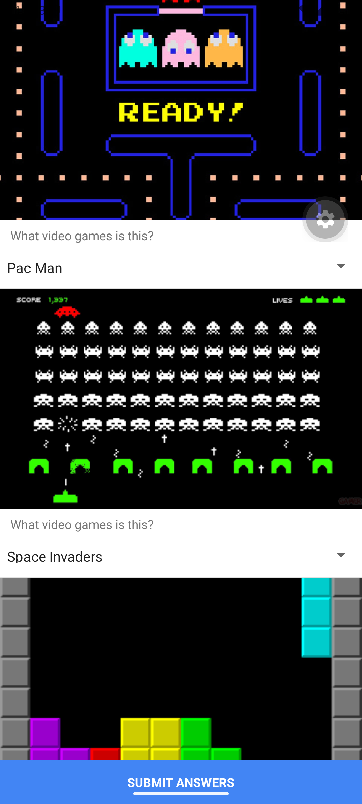

# Video game Quiz

This is the app that let user do a quiz for video games

# Features Highlight

This app features a visually engaging, 
scrollable interface where users identify video games from image prompts using intuitive dropdown menus, culminating in an instant pop-up alert that calculates and displays their final score. 
Under the hood, the codebase demonstrates core React Native concepts including component reusability by passing props between modular files (Interface.js and Quiz.js), 
dynamic state management with the useState hook to track user selections, 
and efficient array rendering using the .map() function. 
The UI is strictly structured using Flexbox, ScrollView, and View to ensure a responsive layout with a continuously pinned submit button at the bottom of the screen.

# ScreenShots of App
Screenshots:  

# Demo Video

Demo Video Link:  
[Screen_recording_20261107_182849.webm](Video/Screen_recording_20261107_182849.webm)